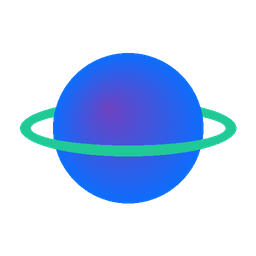

<p align="center">
  
</p>

<h1 align="center">Exoplanet Explorer</h1>

<p align="center">
  <b>Browse 19,000+ Kepler, TESS and K2 objects of interest, and let a LightGBM model judge whether a transit signal looks like a real planet.</b><br>
  Built for the <b>NASA Space Apps Challenge 2025</b> · challenge: <i>A World Away: Hunting for Exoplanets with AI</i>
</p>

<p align="center">
  <a href="https://sayko89.github.io/Exoplanet-App-NASA-Space-Apps-Challenge-/"></a>
  <a href="https://github.com/sayko89/Exoplanet-App-NASA-Space-Apps-Challenge-/actions/workflows/ci.yml"></a>
  
</p>

<p align="center">
  
</p>

The live demo runs entirely in your browser (Streamlit on [Pyodide](https://pyodide.org) via [stlite](https://github.com/whitphx/stlite)); the first visit takes about 20 seconds while Python loads.

## What it does

| Page | |
|---|---|
| **Home** | Totals per mission and a sky map: Kepler's single field, K2's walk along the ecliptic, TESS all over the sky. |
| **Exoplanet List** | Pick Kepler, TESS or K2; filter by status, radius and temperature, search by name, sort by "closest to Earth-like". |
| **Exoplanet Details** | Year, distance, radius, mass; size-vs-orbit chart with the object highlighted; density, transit duration, insolation; side-by-side with Earth. Every object has a shareable URL, e.g. [`?sat=K2&planet=K2-18 b`](https://sayko89.github.io/Exoplanet-App-NASA-Space-Apps-Challenge-/details?sat=K2&planet=K2-18+b). |
| **AI Classifier** | Planet-like signal or false positive? Check any Kepler object, or move eleven sliders and watch the probability change. |
| **Chatbot** | ASTARTE, our Landbot assistant for questions about the missions. |

<p align="center">
  
  
</p>

## The model

Kepler's pipeline flags thousands of periodic dips in starlight. Many are planets; many are eclipsing binaries or noise. The classifier learns which ones look real.

| | |
|---|---|
| Data | Kepler Objects of Interest, cumulative table: 9,564 objects |
| Label | CONFIRMED or CANDIDATE → planet-like (1), FALSE POSITIVE → 0 |
| Features | 11 transit and stellar measurements: period, duration, depth, SNR, number of transits, equilibrium temperature, planet radius, semi-major axis, star temperature, radius and mass |
| Not used | `koi_score` and the false-positive flags: they *are* the vetting result, so using them would leak the answer |
| Model | LightGBM, balanced class weights, median imputation, 156 trees |
| Evaluation | `GroupKFold(5)` by star, so planets of the same star never sit on both sides of a split |
| Result | **ROC AUC 0.923 ± 0.004 · average precision 0.918 · accuracy 84.2 %** |

Every Kepler object in the app shows an *out-of-fold* score: it comes from a model that never saw that star.

The trained trees are exported to JSON and evaluated by a few dozen lines of plain Python ([`backend/classifier.py`](backend/classifier.py)), so the browser demo needs no LightGBM. Training checks that the export matches LightGBM's own predictions.

<p align="center"></p>

## Data

All numbers come from the [NASA Exoplanet Archive](https://exoplanetarchive.ipac.caltech.edu/). [`scripts/build_datasets.py`](scripts/build_datasets.py) turns the raw exports in `data/raw/` into three tables with one shared schema:

| File | Source | Rows |
|---|---|---|
| `data/kepler.csv` | KOI cumulative table (values) + dispositions downloaded Oct 2025 | 9,564 |
| `data/tess.csv` | TESS Objects of Interest, Oct 2025 | 7,699 |
| `data/k2.csv` | K2 Planets and Candidates, Oct 2025 (one default row per planet) | 1,806 |

A value the archive does not have stays empty and shows as "–". The Kepler KOI table has no distances or masses, TESS has no masses, and K2 masses exist only for planets with radial-velocity follow-up.

## Run it locally

```bash
python -m venv .venv && source .venv/bin/activate   # Windows: .venv\Scripts\activate
pip install -r requirements.txt
streamlit run app.py
```

Retrain the model or rebuild the data:

```bash
pip install -r training/requirements.txt
python scripts/build_datasets.py
python training/train_kepler_classifier.py
pytest -q
```

## Project layout

```
app.py                     entry point, page navigation
pages/                     home, explorer, details, classifier, chatbot
backend/                   data loading, shared theme, pure-Python classifier
data/                      the three mission tables (+ raw archive exports in data/raw/)
models/                    exported LightGBM trees and metrics
training/                  training script; notebooks/ has the original hackathon notebooks
scripts/                   dataset builder, static-site builder for the demo
tests/                     page smoke tests and data checks
```

Every push runs the tests, rebuilds the demo, deploys it to GitHub Pages and opens it in a real browser to make sure it boots.

## License

MIT
