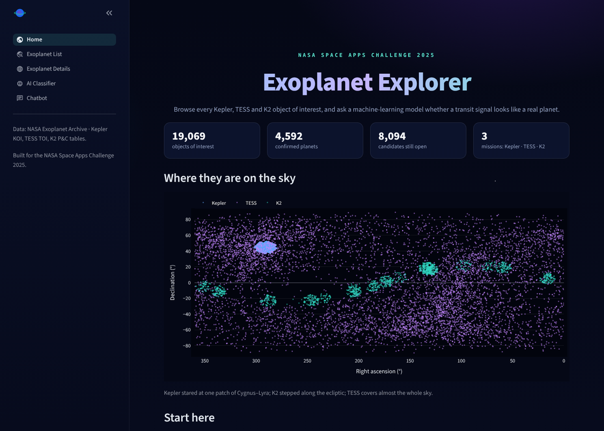
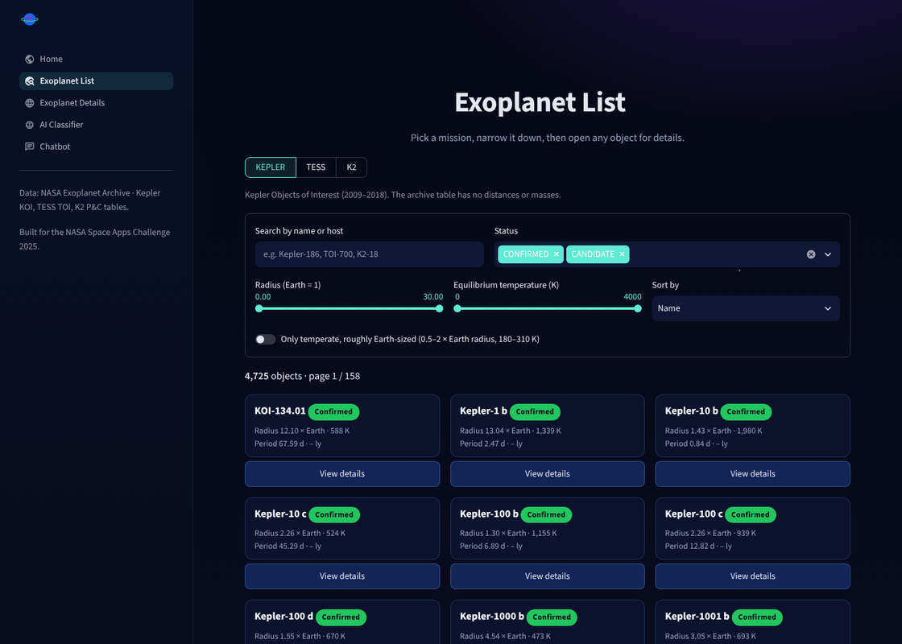
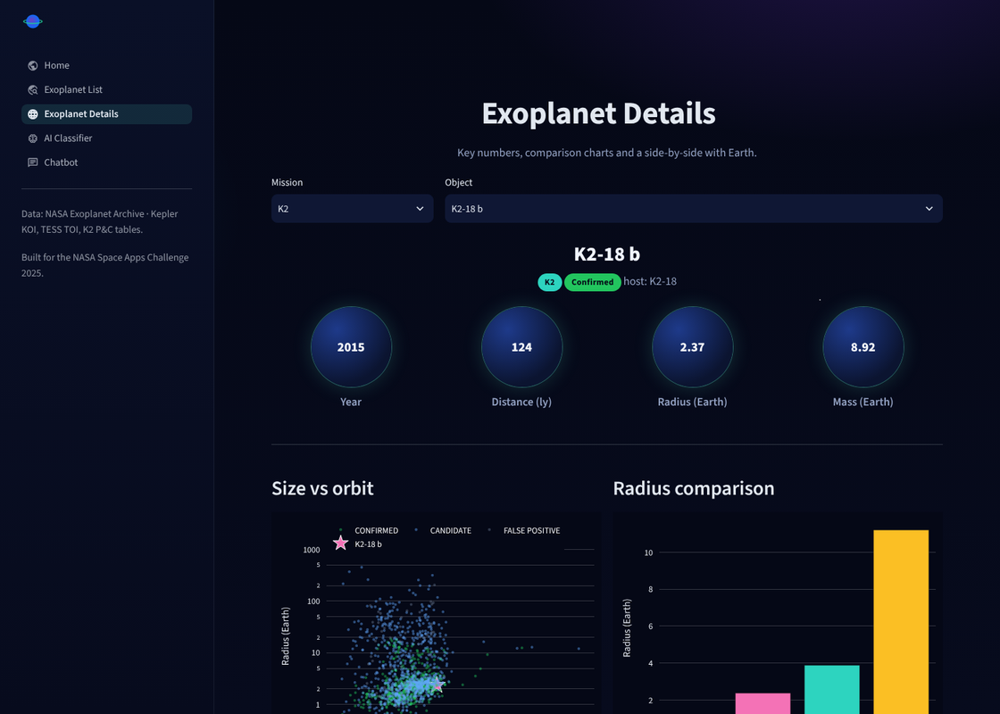
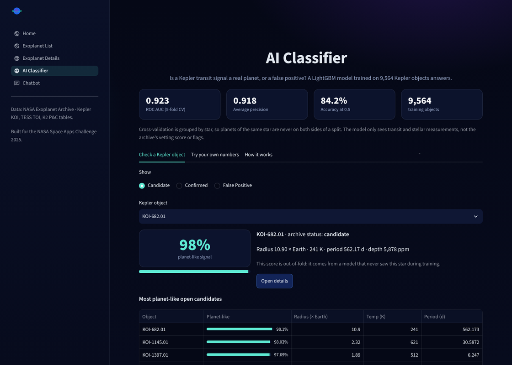
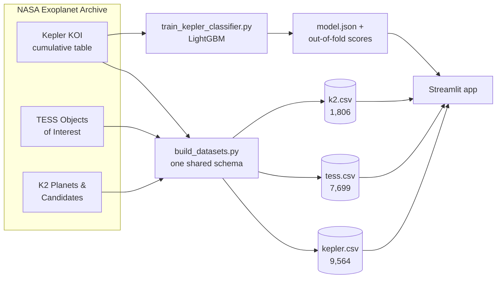

<p align="center">
  <a href="https://sayko89.github.io/Exoplanet-App-NASA-Space-Apps-Challenge-/">
    
  </a>
</p>

<p align="center">
  <a href="https://sayko89.github.io/Exoplanet-App-NASA-Space-Apps-Challenge-/"></a>
  
  
  <a href="https://github.com/sayko89/Exoplanet-App-NASA-Space-Apps-Challenge-/actions/workflows/ci.yml"></a>
</p>

<p align="center">
  <b>Built in 48 hours at NASA Space Apps Challenge 2025</b> for the challenge<br>
  <i>“A World Away: Hunting for Exoplanets with AI”</i>
</p>

---

When a planet passes in front of its star, the star dims by a tiny, regular amount. Kepler, K2 and TESS watched hundreds of thousands of stars for exactly that dip and flagged **19,069 signals**. Some are planets. Many are eclipsing binary stars or instrument noise, and thousands are still waiting for a verdict.

**Exoplanet Explorer** puts all of them in one place and adds a machine-learning model that answers the challenge's question: *does this signal look like a real planet?*

<table>
<tr>
<td align="center"><b>19,069</b><br><sub>objects of interest</sub></td>
<td align="center"><b>4,592</b><br><sub>confirmed planets</sub></td>
<td align="center"><b>8,094</b><br><sub>open candidates</sub></td>
<td align="center"><b>0.923</b><br><sub>ROC AUC, grouped by star</sub></td>
<td align="center"><b>0 servers</b><br><sub>runs fully in the browser</sub></td>
</tr>
</table>

## What's inside

<table>
<tr>
<td width="50%" valign="top">

<h3>A sky full of signals</h3>
Every object from the three missions on one sky map: Kepler's single deep field in Cygnus–Lyra, K2's steps along the ecliptic, TESS across the whole sky.
</td>
<td width="50%" valign="top">

<h3>Search and filter</h3>
Switch between Kepler, TESS and K2, filter by status, size and temperature, or sort by <i>closest to Earth-like</i>. One toggle shows only temperate, roughly Earth-sized worlds.
</td>
</tr>
<tr>
<td width="50%" valign="top">

<h3>Every planet, in detail</h3>
Year, distance, radius, mass, density, transit duration and insolation; where it sits among its neighbours; a side-by-side with Earth. Each planet has its own link, for example <a href="https://sayko89.github.io/Exoplanet-App-NASA-Space-Apps-Challenge-/details?sat=K2&planet=K2-18+b">K2-18 b</a>.
</td>
<td width="50%" valign="top">

<h3>AI Classifier</h3>
Pick any Kepler object and see how planet-like its signal is, or move eleven sliders (period, depth, star size…) and watch the probability change live.
</td>
</tr>
</table>

### Chatbot

The **Chatbot** page hosts a conversational assistant built with Landbot for this project. It answers questions about Kepler, TESS and K2 and about how to use the app.

## Real data, nothing invented

Every number comes from the **[NASA Exoplanet Archive](https://exoplanetarchive.ipac.caltech.edu/)**. One script turns the raw archive exports into three tables with a shared schema, so every page treats the missions the same way.



If the archive does not have a value, the app shows "–" instead of a guess. The Kepler table has no distances or masses, TESS has no masses, and K2 masses exist only for planets with radial-velocity follow-up.

## The model

| | |
|---|---|
| **Question** | Is this transit signal planet-like (confirmed or candidate) or a false positive? |
| **Training data** | 9,564 Kepler Objects of Interest |
| **Features** | 11 measurements: orbital period, transit duration and depth, signal-to-noise, number of transits, equilibrium temperature, planet radius, orbit size, star temperature, radius and mass |
| **Left out on purpose** | the archive's vetting score and false-positive flags, because they *are* the answer |
| **Model** | LightGBM gradient-boosted trees, balanced classes, 156 trees |
| **Validation** | 5-fold cross-validation grouped by star: planets of one star are never on both sides |
| **Result** | **ROC AUC 0.923 ± 0.004 · average precision 0.918 · accuracy 84.2 %** |

Each Kepler object in the app shows an **out-of-fold** score from a model that never saw its star.

To run in the browser without LightGBM, the trained trees are exported to JSON and walked by a few dozen lines of plain Python ([`backend/classifier.py`](backend/classifier.py)). The training script checks that this matches LightGBM's own predictions.

## How the live demo works

There is no backend. The [demo page](https://sayko89.github.io/Exoplanet-App-NASA-Space-Apps-Challenge-/) loads **Python compiled to WebAssembly** ([Pyodide](https://pyodide.org)) and runs the Streamlit app inside your browser with [stlite](https://github.com/whitphx/stlite). The first visit takes about 20 seconds while Python loads; after that, everything you click runs on your own computer.

Every push runs the tests, rebuilds the demo, deploys it to GitHub Pages and opens it in a real browser to make sure every page loads.

## Built with


## Run it locally

```bash
python -m venv .venv && source .venv/bin/activate   # Windows: .venv\Scripts\activate
pip install -r requirements.txt
streamlit run app.py
```

<details>
<summary>Rebuild the data, retrain the model, run the tests</summary>

```bash
pip install -r training/requirements.txt
python scripts/build_datasets.py          # data/raw/* -> data/{kepler,tess,k2}.csv
python training/train_kepler_classifier.py # -> models/, data/kepler_ai.csv
pytest -q
```
</details>

<details>
<summary>Project layout</summary>

```
app.py              entry point and page navigation
pages/              home · explorer · details · classifier · chatbot
backend/            data loading, dark theme, pure-Python classifier
data/               mission tables; raw archive exports in data/raw/
models/             exported LightGBM trees and metrics
training/           training script; notebooks/ holds the original hackathon notebooks
scripts/            dataset builder, static-site builder for the demo
tests/              page smoke tests and data checks
```
</details>

## Acknowledgements

This research has made use of the NASA Exoplanet Archive, which is operated by the California Institute of Technology under contract with the National Aeronautics and Space Administration under the Exoplanet Exploration Program. Created for the [NASA International Space Apps Challenge](https://www.spaceappschallenge.org/) 2025. This project is not endorsed by NASA.

MIT License
